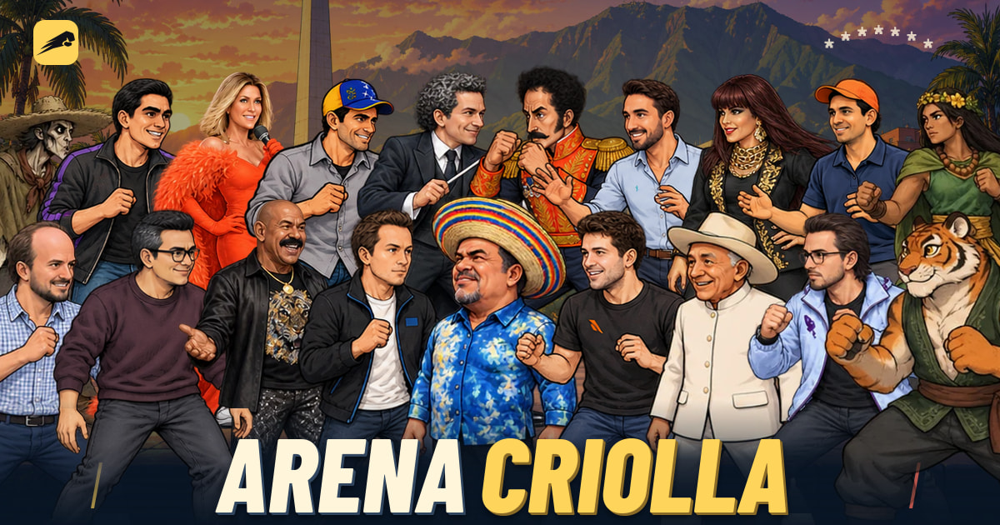

[](https://arenacriolla.com/)

# Arena Criolla

Un juego de pelea donde los mitos, la música, el humor y las figuras de Venezuela se encuentran en la misma arena. Juega desde el navegador, sin instalar nada ni crear una cuenta.

**[Jugar ahora](https://arenacriolla.com/)** · [Desarrollo local](#desarrollo-local) · [Despliegue](docs/deployment.md) · [Licencia](LICENSE)

## Elige a tu pana y pelea

- **55 personajes** con especiales, combos y definitivas propios.
- **9 escenarios** inspirados en Venezuela, de Caracas a Canaima y Los Roques.
- **Tres formas de jugar:** contra la CPU, dos jugadores en el mismo equipo o partidas en línea en salas públicas y privadas.
- **Combate con plataformas:** doble salto, bloqueo y ataques para encontrar tu estilo.
- **Teclado, mando o pantalla táctil.** Los controles se explican dentro del juego.

Para jugar con alguien a distancia, crea una sala y comparte su enlace de invitación. El servidor simula el combate y mantiene la partida sincronizada.

## Desarrollo local

Necesitas **Node.js 24 o posterior** y npm.

```sh
git clone https://github.com/0bkevin/arena-criolla.git
cd arena-criolla
npm ci
npm run dev
```

Abre [localhost:5173](http://localhost:5173). También puedes entrar desde otro dispositivo de la misma red usando la IP de tu equipo. El juego público funciona sin claves de API; las opciones del servidor están en [`.env.example`](.env.example).

## Cómo está construido

React y TypeScript para la interfaz, Canvas 2D para la pelea y Node.js con Express y WebSocket para el servidor. El motor de combate se comparte entre cliente y servidor.

```text
src/       Interfaz, renderizado, controles y audio
shared/    Motor de combate, personajes, escenarios y protocolo de red
server/    Servidor HTTP, salas y simulación en línea
public/    Imágenes, sonidos y fuentes
tests/     Pruebas de combate, red, interfaz y assets
deploy/    Contenedores, proxy y copias de seguridad
docs/      Guías de operación y creación privada de personajes
```

## Validar y compilar

```sh
npm test
npm run check:assets
npm run build
npm start
```

Las pruebas cubren combate, personajes, red y almacenamiento; `check:assets` revisa los sprites públicos. La CI también comprueba dependencias, la imagen de producción y el arranque HTTP/WebSocket.

`npm start` sirve la aplicación compilada. Para configurar el dominio, el contenedor o las imágenes al compartir enlaces, consulta la [guía de despliegue](docs/deployment.md).

## Contribuir

Crea una rama por tarea desde `origin/main`, mantén los cambios acotados y ejecuta las validaciones antes de abrir un PR. La configuración para nuevos hilos de T3 Code está documentada en la [guía de desarrollo](docs/development.md).

El taller público de personajes está desactivado. El flujo privado del operador se documenta en [creación de personajes](docs/creator-codex.md) y [configuración en Oracle](docs/codex-operator-oracle.md).

## Licencia

Código y materiales originales bajo [GPL-3.0-only](LICENSE). Los sonidos de terceros conservan CC0 y las fuentes, SIL Open Font License. Consulta las atribuciones en [ASSET-LICENSES.txt](ASSET-LICENSES.txt).
