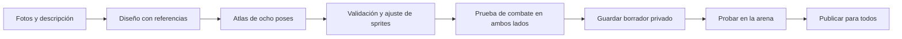

# Arena Criolla

Elige tu personaje y échate una partida con tus panas, en el mismo dispositivo
o en línea. También puedes jugar contra la CPU. Gratis y sin registro.

## Licencia y distribución

El código y los materiales originales del proyecto se distribuyen bajo **GPL-3.0-only**; el texto completo está en [LICENSE](LICENSE). Los sonidos de terceros conservan CC0 y las fuentes conservan SIL Open Font License; consulta [ASSET-LICENSES.txt](ASSET-LICENSES.txt).

El repositorio incluye los assets necesarios para jugar en `public/`, los PNG editables en `assets/source/` y los originales generados necesarios para los scripts de preparación. No hace falta descargar assets desde Google Drive. Los paquetes grandes opcionales se pueden distribuir como archivos de una GitHub Release.

Las fotografías, entrevistas y otros medios descargados para investigación, las voces retiradas y las miniaturas de referencia quedan fuera de esta publicación. Los informes históricos conservan sus enlaces y rutas de investigación; esas rutas locales pueden no existir en un clon público. Los secretos y los datos privados del taller tampoco se distribuyen.

Juego de pelea en español con 52 personajes. Conserva estas 15 figuras venezolanas: Vicente Zavarce, Pedro Vallenilla, Javier Hala Madrid, Capriles Radonski, Renny Ottolina, Juan Vicente Gómez, Simón Díaz, Er Conde del Guácharo, Emilio Lovera, Maite Delgado, Óscar D’León, El Puma, Luis Chataing, George Harris y María Corina Machado. Se suman Alí Primera, Gualberto Ibarreto, Reynaldo Armas, Gustavo Dudamel, Danny Ocean, Nacho, Daniel Sarcos, Yordano, Lila Morillo, Rummy Olivo, Chiquinquirá Delgado, Norkys Batista, Gabriela Spanic, Amanda Gutiérrez, Lele Pons y Giuseppe Gangi. También se incorporan Enrique Rivas (Fina), Jesús Castillo (Kontigo), Carlos García Ottati (Kavak), Víctor Cárdenas (Slash) y Juan José Pocaterra (Vikua y La Wawa). Se incorporan Lorenzo Mendoza, Carolina Herrera, Dayana Mendoza, Simón Bolívar y Édgar Ramírez. Se suma Melanio Escobar (@melaniobar), con sus lentes, gorra, tatuajes y el especial «Señal libre». También están El Silbón, La Llorona, La Sayona, María Lionza, Florentino, El Diablo de los Llanos, Doctor Knoche, El Momoy, Tío Tigre y Tío Conejo. Combina vida, bloqueo y combos con plataformas, doble salto, empujones y eliminación por caída.

## Melanio Escobar (v44)

Se incorpora como el luchador 52 con ocho poses de combate, introducción y selección de una sola ejecución, celebración, tres combos y el especial de ida y vuelta «Señal libre». Conserva lentes, gorra hacia atrás, bigote y tatuajes a partir de [referencias visuales primarias](docs/research/escobar-identity-v44.md). La [revisión y validación](docs/melanio-v44/review.md), los [prompts](docs/melanio-v44/prompts.json) y la [vista de poses](docs/melanio-v44/preview.html) documentan el resultado.

La [revisión adversarial de movimiento v45](docs/melanio-v45/review.md) corrigió las fases visuales de «Señal libre» y añadió pruebas de movimiento, plataformas, reflejos, entradas de red y controles táctiles. Pasan 813 pruebas; la matriz determinista recorre 432 combinaciones de escenario, rival, lado y dificultad.

## Jugar y desarrollar

Requiere Node.js 24 o posterior (SQLite integrado).

```bash
npm install
npm run dev
```

Abre `http://localhost:5173`. El servidor escucha en todas las interfaces: para jugar desde otro dispositivo de la misma red, abre `http://IP-DEL-EQUIPO:5173`. Escribe un apodo, elige un personaje y un escenario.

- **Pelea rápida:** juega contra CPU en tres dificultades.
- **Con un pana:** dos jugadores en el mismo teclado o con dos mandos.
- **En línea:** crea una sala pública o privada, comparte la invitación y ambos marcan «Estoy listo». Cada persona usa los controles del jugador 1 en su dispositivo.

Las salas y las partidas en red funcionan en el servidor Node por WebSocket, sin cuentas. El servidor está desplegado en Oracle y disponible en https://arenacriolla.com/. Las direcciones https://arena.kevinbravo.com/ y https://www.arenacriolla.com/ redirigen al dominio principal, conservando ruta y parámetros.

## Marca del juego

El logo es un puño que avanza con una estela detrás. Lo verás en la cabecera,
la pestaña del navegador y los accesos de móvil. El SVG editable está en
`public/assets/arena-mark.svg`; `npm run assets:brand` regenera el favicon,
los PNG y `assets/icon.svg` con el amarillo de los botones. Consulta
[los archivos y la procedencia de la marca](docs/brand/README.md).

## Taller desactivado

La creación de personajes está desactivada temporalmente en el juego. Se retiraron los accesos de escritorio y móvil, y el cliente no incluye el taller. Los enlaces antiguos de `/create` vuelven al inicio; las rutas públicas `/api/creator` y `/api/auth` responden 404. La arena, las salas y los personajes ya publicados siguen disponibles sin cuenta.

El código y los datos se conservan para una reactivación futura. `ARENA_CREATOR_ENABLED=true` por sí solo no vuelve a publicar el taller ni inicia generaciones en el servidor del juego. Las pruebas aisladas del módulo habilitan explícitamente `workshopEnabled: true`; la entrada normal de desarrollo y producción lo mantiene cerrado. El resto de esta sección documenta el módulo conservado, que no forma parte de la interfaz pública actual.

El grafo real de LangGraph vive en `server/creator/pipeline.ts`:



La IA define apariencia, saludo y nombres de movimientos. La física utiliza tres recetas existentes y equilibradas; no ejecuta código generado. El atlas debe tener transparencia, ocho poses completas, márgenes y orientación hacia la derecha. Un atlas inválido queda como trabajo fallido y puede volver a dibujarse al continuar. El diseño y los archivos ya completados se reutilizan. Tras un reinicio, los trabajos interrumpidos esperan que su dueño pulse **Continuar**, para evitar repetir automáticamente una petición de imagen con costo. No genera voces: mantiene las reacciones genéricas y efectos de combate del juego.

El taller guarda el borrador y sus fotos en IndexedDB por cuenta, en el mismo dispositivo. Al volver recupera los trabajos guardados en el servidor; una clave de solicitud persistente evita repetir una creación ya aceptada. Un reinicio durante una llamada pagada espera una continuación manual. SQLite guarda cuentas, sesiones, propiedad, estados y definiciones. `ARENA_DATA_DIR` (por defecto `data/creator/`) contiene `arena.sqlite`, fotos privadas en `uploads/`, atlas y `character.json` por luchador en `characters/`, y el catálogo `community.json`. Esta carpeta está excluida de Git y del contexto Docker. Debe ser persistente y escribible; respalda la base y los archivos juntos. Las fotos solo las puede leer su dueño, también durante el desarrollo: el servidor bloquea las URLs directas de archivos privados. La carpeta de datos debe estar fuera de `public/` y `dist/`. Al eliminar un borrador se eliminan sus archivos; al retirar uno publicado desaparece del selector y se borran sus fotos, conservando el arte publicado para las peleas ya iniciadas.

Las contraseñas usan scrypt con sal individual y las sesiones usan cookies HttpOnly. El servidor comprueba propiedad en cada acción y limita creaciones a doce visibles y una activa por usuario. Es una implementación de un solo proceso: no incluye verificación por correo, recuperación de contraseña ni un servicio distribuido de trabajos.

El taller ejecuta dos generaciones a la vez y admite hasta doce trabajos entre ejecución, cola y subidas reservadas. Solo permite dos subidas simultáneas y reserva el cupo antes de leer archivos en memoria. Las peticiones que exceden capacidad reciben 503 con `Retry-After`; los límites diarios responden 429. Una subida tiene 30 segundos para completar su cuerpo y cada trabajo tiene un plazo total de 300 segundos. Los límites son configurables mediante `ARENA_CREATOR_CONCURRENCY`, `ARENA_CREATOR_CAPACITY`, `ARENA_CREATOR_UPLOADS`, `ARENA_CREATOR_UPLOAD_TIMEOUT_MS` y `ARENA_CREATOR_JOB_TIMEOUT_MS`, con valores enteros y unidades en milisegundos para los plazos.

SQLite conserva una cuota móvil de 24 horas: cincuenta intentos globales y seis por usuario por defecto (`ARENA_CREATOR_DAILY_ATTEMPTS` y `ARENA_CREATOR_USER_DAILY_ATTEMPTS`). Incluye reintentos y no se reinicia al eliminar personajes o reiniciar Node. La reserva y la escritura del trabajo son una transacción. Son límites de intentos, no un presupuesto monetario ni protección completa contra cuentas abusivas. No añadas réplicas: la cola y los cupos de ejecución/subida son locales al proceso.

Si falla también la escritura que registra un error de generación, el taller se detiene sin cerrar las partidas. `/api/creator/capabilities` pasa a indicar que no está disponible. Corrige el almacenamiento y reinicia el proceso para recuperarlo; supervisa ese endpoint y los registros además de `/api/health`, que indica disponibilidad de la arena. Una imagen completamente guardada se reutiliza aunque falle el registro de su ruta en SQLite. Un timeout no puede demostrar si el proveedor cobró una petición interrumpida, y el usuario decide si continúa.

`npm run test:creator` comprueba el grafo real con un proveedor determinista de prueba, autenticación, privacidad, reinicios, sprites y publicación por WebSocket. Estas pruebas no llaman a la API de generación ni validan la semejanza de una imagen producida por el modelo real.

Para preparar personajes de forma privada con la sesión de ChatGPT, `npm run creator:codex -- doctor` comprueba el acceso y `npm run creator:codex -- login` inicia el acceso por navegador. El flujo de Codex SDK valida referencias parciales, genera el atlas, comprueba las poses y prueba el combate. Solo el paquete de arte terminado se importa a `prod-tst`, como borrador del dueño indicado. El servidor del juego no recibe credenciales de ChatGPT. Consulta [la guía de generación e importación](docs/creator-codex.md) para comandos, revisión visual y recuperación de fallos.

En el servidor Oracle, la sesión de ChatGPT y una generación real del [generador privado del operador](docs/codex-operator-oracle.md) ya se verificaron. El dueño autoriza usar primero la cuota de su suscripción y luego sus créditos. Ambos turnos de razonamiento usan `gpt-6-luna` con esfuerzo `high`; la herramienta de imágenes dibuja con `gpt-image-2`. El contenedor sigue separado del juego, sin recurrir a la clave de API ni procesar solicitudes públicas.

La generación automática para visitantes permanece desactivada y no requiere configurar credenciales. La [guía de producción anterior](docs/production-creator.md) se conserva como referencia histórica; sus pasos de activación no habilitan la interfaz ni las rutas públicas de esta versión.

`npm run test:adversarial` añade sobrecarga, peticiones simultáneas, entradas inválidas, errores de SQLite, resultados tardíos, recuperación de imágenes, coherencia del catálogo, aislamiento de salas y el adaptador OpenAI contra un servidor HTTP local. Los informes independientes de Luna con razonamiento extra alto están en `docs/adversarial-v31/`. El workflow `.github/workflows/ci.yml` ejecuta pruebas, validación de assets, compilación y un arranque HTTP del contenedor; no prueba cuentas reales de OpenAI, dispositivos físicos ni escalado distribuido.

Limitación pendiente de retención: retirar un personaje publicado elimina sus fotos y lo oculta de la selección, pero conserva su arte generado y permite descargarlo por su URL anterior indefinidamente. No existe todavía una purga de esos archivos. Supervisa el crecimiento del volumen y respalda la base y los archivos juntos; la cuota diaria limita el ritmo de creación, no el almacenamiento acumulado.

## Controles

| Acción              | Jugador 1 / en línea | Jugador 2 local |
| ------------------- | -------------------- | --------------- |
| Mover               | A / D                | ← / →           |
| Doble salto         | W                    | ↑               |
| Bajar de plataforma | S                    | ↓               |
| Golpe ligero        | J                    | 1               |
| Golpe fuerte        | K                    | 2               |
| Especial            | L                    | 3               |
| Bloquear            | Mantener U           | Mantener 0      |
| Esquivar            | Shift izquierdo      | Enter           |
| Definitiva          | I                    | 5               |
| Pausa / menú        | Esc                  | Esc             |

En móvil aparecen botones táctiles. También hay controles de mando estándar: stick, A, B, X, Y, LB, RB y RT. Los números del jugador 2 funcionan en la fila superior y en el teclado numérico.

Cada pelea tiene dos vidas por jugador y 90 segundos. El daño aumenta el empuje. Un especial cuesta 25 de energía; golpear y recibir golpes recarga la barra. Los combos se desbloquean por personaje: J → K desde el inicio, J → J → K con una victoria, definitiva I con tres victorias y 75 de energía. La secuencia se completa en 2,5 segundos, dejando terminar la recuperación de cada ataque.

El progreso se guarda en `localStorage`, en el navegador usado. No es una clasificación global ni una identidad verificada. El ranking global se deja pendiente. Las victorias de la CPU no desbloquean combos para el jugador.

## Producción

```bash
npm run build
npm start
```

`PORT` configura el puerto (5173 por defecto). Cliente, `/api/health`, `/api/rooms` y `/ws` se sirven desde el mismo origen. El alojamiento debe admitir un proceso Node persistente y conexiones WebSocket; un alojamiento exclusivamente estático no sirve las salas. Con HTTPS, el cliente usa automáticamente WSS.

Configura `ARENA_PUBLIC_URL` con el origen público completo (por ejemplo, `https://arena.example`, sin rutas) al desplegar detrás de un proxy. El servidor lo utiliza para las URLs canónicas, Open Graph, Twitter y `/sitemap.xml`; sin esta variable utiliza el origen de la petición. Los metadatos se sirven en el HTML inicial para que funcionen sin JavaScript. `/robots.txt` anuncia el sitemap. La imagen social de 1200 × 630 está en `public/assets/og-arena-criolla.png`; `npm run assets:og` la regenera con los escenarios, luchadores y fuentes originales del lobby.

También se incluye un Dockerfile:

```bash
docker build -t arena-criolla .
docker run --rm -p 5173:5173 --env-file .env -v arena-data:/app/data arena-criolla
```

`deploy/prod-tst.compose.yaml` levanta una instancia de pruebas con `NODE_ENV=production`, su propia base SQLite y archivos en `/var/lib/arena-criolla-prod-tst/`, y el puerto privado `127.0.0.1:35174`. Crea esa carpeta con dueño `1000:1000` y permisos `700`; configura `OPENAI_API_KEY` en `/etc/arena-criolla-prod-tst/server.env` con permisos `600`. Ejecuta `sudo docker compose -f deploy/prod-tst.compose.yaml up -d --build --wait` desde el repositorio en el servidor. Esta instancia admite una generación simultánea y diez intentos diarios. Para rotar la clave, edita ese archivo y ejecuta el mismo comando con `--force-recreate`. El endpoint de capacidades confirma configuración; una generación real es necesaria para comprobar acceso y saldo del proveedor.

Las salas viven en memoria, expiran por inactividad y se eliminan al quedar vacías. Reiniciar el servidor cierra las partidas existentes. Esta versión usa un único proceso; persiste cuentas y personajes en SQLite; no incluye ranking, espectadores, emparejamiento competitivo, rollback ni escalado entre instancias. La simulación de combate corre en el servidor a 60 Hz y envía estados a 30 Hz. Los resultados y movimientos se resuelven allí; los desbloqueos iniciales proceden del progreso local de cada invitado y no se consideran verificables para un futuro ranking.

Mientras una sala espera jugadores, la versión web reserva durante cinco minutos el lugar de quien pierde la conexión al cambiar de aplicación o compartir la invitación. Al volver o recargar la misma pestaña, recupera el código, el anfitrión y la selección mediante una credencial privada en `sessionStorage`; la credencial nunca forma parte del enlace compartido. «Salir de la sala» cancela esa recuperación. Las partidas en curso conservan su comportamiento de salida al desconectarse y las salas no sobreviven a un reinicio del servidor.

El acceso al juego queda abierto, sin un máximo fijo de conexiones ni de salas. La capacidad práctica depende de la CPU, memoria, ancho de banda y latencia del servidor; eliminar los topes no garantiza un número ilimitado de partidas fluidas.

En `t3code-agents`, `deploy/production.compose.yaml` publica el contenedor solamente en `127.0.0.1:35173`, con datos persistentes en `/workspace/arena-criolla-production/data` (dueño `1000:1000`, permisos `700`). Caddy importa `deploy/Caddyfile.site` para HTTPS y WSS. La configuración privada vive en `/etc/arena-criolla/server.env` y la imagen seleccionada en `/etc/arena-criolla/release.env`, ambos con permisos `600`; `ARENA_IMAGE` selecciona una imagen ya construida. Usa `ARENA_TRUST_PROXY=loopback,uniquelocal` solamente detrás de este proxy privado. El taller y su proveedor permanecen desactivados.

`deploy/backup.py` usa la copia en línea de SQLite sin pausar las partidas; `deploy/arena-criolla-backup.timer` programa una copia diaria a las 09:00 UTC, con hasta cinco minutos de variación. Conserva siete archivos privados en `/var/backups/arena-criolla`. Son copias locales: todavía hace falta configurar un destino externo para sobrevivir a la pérdida de la VM y sus discos. La instalación usa `/opt/arena-criolla/backup.py` y `/opt/arena-criolla/compose.yaml`.

El contenedor ejecuta Node como usuario `1000`, con la raíz de solo lectura, `/tmp` limitado a 128 MiB y el volumen de datos escribible. La imagen final excluye npm y Yarn; la configuración de producción deja vacía la clave del proveedor mientras el taller permanece desactivado. Las conexiones WebSocket del navegador requieren el mismo origen completo, incluidas las direcciones temporales servidas por el proxy; los clientes sin `Origin` siguen admitidos como visitantes. `Origin` no autentica usuarios ni impide bots. La página usa CSP con un nonce nuevo por respuesta, evita almacenar HTML con invitaciones y conserva la caché de los archivos versionados, el audio, los estilos dinámicos y los controles del juego.

La CI ejecuta `npm audit` sobre el archivo de dependencias completo y Trivy sobre la imagen final, sin omitir avisos sin parche, y prueba HTTP y WebSocket con un contenedor de solo lectura. El ejecutable de Trivy está fijado por versión y SHA-256. `node scripts/security-smoke.mjs https://arenacriolla.com` comprueba cabeceras, rechazo de otros orígenes, taller desactivado y una partida privada con dos visitantes temporales; no usa cuentas ni proveedores. La revisión y sus límites están en [docs/security-audit.json](docs/security-audit.json). Los pasos preparados para actualizar el proxy compartido y reiniciar la VM están en [deploy/security-maintenance.json](deploy/security-maintenance.json); esa intervención requiere coordinar la interrupción de los otros servicios de `t3code-agents`. Un escaneo sin avisos no garantiza que no existan vulnerabilidades; el aviso de Node del 14 de octubre anuncia parches para el 21 de octubre de 2026 que aún deben aplicarse cuando estén disponibles.

El progreso guardado en el navegador es declarado y no verificado. En multijugador, el servidor valida las entradas y simula la pelea, pero acepta el contador de victorias del visitante para los desbloqueos; un cliente modificado puede atribuirse victorias y adelantar el combo avanzado y la definitiva, respetando sus requisitos de energía. Este historial no acredita resultados competitivos ni debe autorizar rankings o premios verificados. Las reglas competitivas con desbloqueos iguales para ambos jugadores o un historial separado validado por servidor requieren un diseño específico que conserve el progreso local y el juego sin cuenta.

`npm run perf:engine` recorre los 52 luchadores y nueve escenarios con una reproducción determinista. `npm run perf:network` inicia su propio servidor temporal y 500 clientes WebSocket locales; `ARENA_PERF_PLAYERS`, `ARENA_PERF_SECONDS` y `ARENA_PERF_ROSTER=all` permiten variar la carga. No envía tráfico a producción. Las mediciones, límites de interpretación y comprobaciones están en `docs/performance-audit.json` y `docs/production-deployment.json`.

## Nuevos iconos y correcciones v39

Lorenzo Mendoza, Carolina Herrera, Dayana Mendoza, Simón Bolívar y Édgar Ramírez tienen ocho poses, entrada, celebración, tres combos y especial propio. Sus mecánicas incluyen proyectiles que ralentizan, reflejo de proyectiles, pulsos expansivos, una carga y una contra frontal. Capriles recibe un acabado ilustrado consistente con el elenco y Javier Hala Madrid recibe una cabeza menor y un cuerpo mejor proporcionado; ambos tienen entradas redibujadas. Se conservan sus habilidades anteriores.

La [revisión individual y los assets](docs/roster-expansion-v39/review.md), las [fuentes primarias](docs/roster-expansion-v39/research.md), los [prompts](docs/roster-expansion-v39/prompts.json) y la [evidencia de ejecución](docs/roster-expansion-v39/runtime-qa.json) documentan el trabajo. Los 51 pares de atlas pasan validación y la suite incluye 731 pruebas, con combates deterministas y comprobaciones individuales de los siete personajes revisados.

## Parecidos y uniforme Vinotinto v40

Javier Hala Madrid y Nacho tienen nuevos sprites de combate y entrada basados en referencias de octubre y mayo de 2026. Dayana Mendoza lleva el uniforme Vinotinto solicitado, inspirado en la camiseta oficial de 2026. Los tres mantienen la ilustración del elenco y proporciones adultas.

La [revisión y las fuentes individuales](docs/identity-v40/review.md), los [prompts reproducibles](docs/identity-v40/prompts.json) y la [evidencia de ejecución](docs/identity-v40/runtime-qa.json) incluyen la comparación antes/después. Pasan 737 pruebas, los 51 pares de atlas y la compilación de producción.

## Revisión adversarial interactiva v41

Los ocho personajes recientes se probaron contra rivales distintos en CPU, local y multijugador, cubriendo los nueve escenarios. Se corrigió la pose de la carga de Bolívar y se añadieron diez pruebas adversariales de combate, renderizado y WebSocket. La suite completa pasa con 747 tests. El [informe con matriz, límites y evidencia](docs/adversarial-roster-v41/report.md) incluye la revancha, el reingreso a una sala y controles táctiles simulados.

## Apariencia final de Javier y Nacho v42/v43

La versión elegida de Javier Hala Madrid usa la fotografía aportada por el usuario: rostro sin barba, copete alto, sonrisa amplia y camiseta azul marino. Las poses de combate y entrada se generaron en pares para conservar su identidad; se corrigieron la alternancia de carrera y la orientación de la reacción al golpe. Nacho usa el retrato de corte rapado y barba corta; Dayana conserva el uniforme Vinotinto.

La [revisión final de Javier](docs/identity-v43/review.md) y la [revisión de Nacho](docs/identity-v42/review.md) conservan prompts, fuentes seleccionadas, atlas y evidencia de ejecución. Las cifras de pruebas en los informes v39/v40/v41 corresponden a sus revisiones históricas; CI valida el estado integrado actual.

## Nuevos fundadores y celebraciones

Los cinco nuevos personajes reúnen las seis empresas solicitadas: Juan José Pocaterra representa a Vikua y La Wawa. Para La Wawa se eligió la referencia de CEO actual tras la aclaración del usuario; las fuentes recientes lo presentan como CEO y WEF lo denomina presidente. Mafe Vera figura en la investigación como cofundadora y ex CEO, sin personaje jugable. La evidencia y las diferencias de fechas/cargos están en [investigación de Vikua y La Wawa](docs/founders/research-vikua-wawa.md). Las otras fichas se apoyan en [Fina y Kontigo](docs/founders/research-fina-kontigo.md) y [Kavak y Slash](docs/founders/research-kavak-slash.md).

Cada fundador tiene ocho poses transparentes, entrada propia, especial distinto y celebración. Se inspeccionaron al menos tres fotos por persona; los atlas finales se generaron con la herramienta integrada `image_gen.imagegen`, manteniendo el estilo de los luchadores existentes. Los [prompts](docs/founders/sprite-prompts.json), las [correcciones](docs/founders/correction-prompts.json) y los [archivos finales](docs/founders/generated-assets.json) documentan el proceso. `tests/founders.test.ts` comprueba sus ataques en ambos lados, bloqueo y reproducción determinista.

La [revisión de estilo v3](docs/founders/style-v3/review.md) reemplaza los cinco atlas originales por dibujos nuevos basados en los retratos reales y en el estilo ilustrado de Renny. Cada fundador conserva su ropa, especial y animaciones, con una postura inicial más compacta y rasgos menos genéricos. Los PNG de 2048×1024 y los WebP sin pérdida contienen ocho siluetas completas, separadas y alineadas. Los prompts, fuentes, originales generados y auditorías de empaquetado quedan conservados; `scripts/pack-founder-style-v3.ts` permite reproducir el empaquetado. La galería de fundadores utiliza el mismo cargador y dibujado que el juego.

Los 52 luchadores muestran una celebración individual de 3,5 segundos antes del resultado: música original de victoria, gesto del ganador y breve reacción del derrotado, visible incluso tras una caída fuera de la arena. Se respetan silencio, movimiento reducido, pestaña oculta y limpieza al salir o reiniciar.

## Revisión individual del elenco v28

Se asignó un agente independiente a cada uno de los 41 luchadores existentes. Cada revisión conserva un informe y un archivo de pruebas propios en `docs/character-audits-v28/` y `tests/character-audits/`: caminar, saltar, golpes, especial frente a guardias, combos, ambas posiciones, una pelea completa contra CPU con reproducción determinista, ocho sprites y presentaciones en el navegador nativo.

La integración corrigió embestidas que atravesaban al rival sin pegar, frenado de avances, golpes terrestres sin contacto con el suelo, diferencias de empuje y ventanas de contraataque entre jugadores, las cuatro pisadas de Rummy, la emisión terrestre de María Lionza, el origen del doble de Gabriela y el alcance usado por la CPU para proyectiles que regresan. También aisló píxeles ajenos en recortes superpuestos, mejoró las poses de especiales, añadió el cuatro visible de Simón y retiró el libro flotante de Amanda. Óscar conserva su entrada aprobada v25 y Dudamel la v24; las entradas y gestos de selección siguen terminando una sola vez en guardia.

`npm run test:characters` ejecuta estas revisiones. Los informes originales registran lo observado durante cada auditoría; el índice `docs/character-audits-v28/index.json` registra las resoluciones centrales y la verificación final. Son comprobaciones funcionales y visuales del juego, no un estudio de balance competitivo ni una nueva verificación de la biografía de cada figura.

## Arte y assets

Las ilustraciones se generan con la herramienta integrada `image_gen.imagegen` a partir de fotografías reales para las figuras históricas y actuales, y de referencias culturales para las diez adaptaciones del folklore. Los quince personajes anteriores tienen investigación de un agente GPT-6-Luna con razonamiento alto; la sustitución actual asignó un agente a Vicente Zavarce y otro a Pedro Vallenilla. Cada dossier documenta identidad, ropa, gestos, fotos, clips, fuentes y límites de verificación. El elenco activo y sus atributos están en `shared/fighters.json`.

Los 46 atlas incluyen ocho poses cada uno: reposo, bloqueo, dos de carrera, salto, puño, patada y daño, 368 poses en total. El juego carga WebP con transparencia y geometría validada para alinear los pies y evitar recortar extremidades. Vicente Zavarce y Pedro Vallenilla usan atlas v5 nuevos basados en sus propias fotos. Javier conserva su atlas v2 revisado; los otros doce personajes usan atlas v3. Hay nueve escenarios: Altamira, La Guaira, Valencia, Salto Ángel, puente de Maracaibo, teleférico de Mérida, Médanos de Coro, Los Roques y Poliedro de Caracas. Los seis nuevos fondos usan pixel art a 540×320 y WebP sin pérdida. Los movimientos, las plataformas y el combate son ficción de juego.

El botón «Ver los 9 escenarios» abre el catálogo. Todos usan un suelo compacto de 1020 unidades y una zona física de 1200 × 800, con un lienzo de 1440 × 800 que conserva las proporciones. La retirada voluntaria se limita a 660 unidades entre luchadores en partidas locales y de red; el movimiento hacia el rival queda libre. Los empujes de golpes y el transporte de plataformas conservan su recorrido y permiten caídas. La cámara mantiene un encuadre cercano con un recorrido lateral corto y espacio para saltos; el fondo permanece anclado al mundo. El movimiento reducido conserva una vista general estable. Las plataformas están más separadas y tienen un borde del color del escenario; conservan sus alturas de acceso y algunos cruces requieren doble salto. Cinco escenarios tienen una plataforma móvil: la cabina de Mérida se desplaza lateralmente, el elevador del puente y la roca de Canaima suben y bajan, la tarima de Coro se desliza y la balsa de Los Roques se mece. Los jugadores viajan con ellas, pueden saltar o bajar pulsando S. El Poliedro ofrece un combate a ras del suelo. Cabinas, barcos, aves, niebla, nieve, arena y focos se animan en el fondo. La posición física de las plataformas se calcula a partir del tick compartido por cliente y servidor. Las revisiones individuales están en `docs/stage-audits/`.

Los originales generados de los escenarios están en `assets/references/stages-v4/`, las versiones para el juego en `assets/source/` y `public/assets/`, y los prompts y fuentes en `docs/stage-prompts-v4.json` y `docs/stage-art-v4.json`.

- Referencias reales: `assets/references/`.
- Atlas PNG: `assets/source/`; WebP del juego: `public/assets/`.
- Investigación y prompts actuales: `docs/characters-v3/` y `docs/characters-v5/`.
- Manifiesto de identidad: `docs/character-manifest.json`.
- Comparación de fotos y modelos: `docs/character-preview.html`.
- Validación de transparencia y ocho poses: `docs/character-sprite-qa.json`.
- Comprobación actual en navegador, combate, audio y salas: `docs/character-runtime-qa-v5.json`.
- Registro de los 15 agentes Luna con razonamiento alto: `docs/character-agents-v5.json`.
- Procedencia, tiempos y SHA-256 de cada audio: `docs/audio-provenance.json`.
- Archivo histórico de las voces retiradas: `assets/archive/v8-original-voices/` y `assets/archive/v2-voices/`, fuera del contenido servido por el juego.
- Galería animada de los seis escenarios nuevos y muestras de golpes: `docs/stages-preview-v4.html`.
- Comprobación de escenarios, plataformas, catálogo, sonido y combate: `docs/stage-runtime-qa-v4.json`.

`npm run assets` prepara únicamente los atlas y escenarios activos. `npm run check:assets` comprueba ocho siluetas completas, cuatro por fila, transparencia, bordes y paridad PNG/WebP. Para validar un personaje durante su preparación: `node scripts/validate-character-assets.mjs --sprite simon-v3`.

Vicente invoca siete moticos Yummy con «Entrega exprés» (`L`): aparecen juntas, escalonadas en un pelotón compacto y alargado, con daño y empuje por cada moto que conecta. Los repartidores y motos usan un atlas ilustrado con cuatro cuadros de conducción, creado a partir de referencias reales y con el mismo acabado que los luchadores. Cada moto conserva una escala de unos dos metros de largo respecto a un luchador de 177 unidades de altura; la profundidad visual del grupo no cambia su tamaño. Avanzan por la altura desde la que se invocaron. Requiere estar en el suelo o una plataforma y consume 25 de energía; se pueden bloquear o saltar. Referencias, prompt y preparación del atlas: `docs/yummy-motos/` y `scripts/prepare-yummy-motos.mjs`. Pedro lanza tres tarjetas separadas con «Tres cuotas». Ambos conservan combos y desbloqueos propios. John Acquaviva y Kilómetro están retirados del elenco y sus archivos servidos se conservaron en `assets/archive/v5-retired/`.

Los especiales tienen reglas diferentes: dos pulsos de Renny, pisada terrestre de Gómez, abanico de notas de Simón, embestida del Conde, golpe en dos tiempos de Emilio, foco de Maite, giro aéreo de Óscar, cono de empuje del Puma, señal de regreso de Chataing, remate con pausa de George y avance con salto de María Corina. Estas reglas se comparten entre partidas locales y servidor.

## Sonido de combate

Los 41 personajes están sin diálogos ni grabaciones de las personas reales. La selección, los especiales y las victorias ya no reproducen sus frases. Los audios anteriores y su investigación se conservan en `assets/archive/v8-original-voices/` y no se incluyen en la aplicación publicada.

El combate usa 18 reacciones genéricas y breves de esfuerzo y dolor: tres variantes al saltar, atacar y recibir daño, con dos bancos de intérpretes ajenos a las personas del elenco. Proceden de [qubodup](https://opengameart.org/content/15-vocal-male-strainhurtpainjump-sounds) y [cicifyre](https://opengameart.org/content/female-rpg-voice-starter-pack), publicados como CC0. Se incluyen únicamente vocalizaciones no verbales. Los archivos locales `public/audio/arcade/` pesan unos 90 KB en total y se precargan al preparar una pelea.

Las reacciones siguen los eventos reales del motor en partidas locales y multijugador: esfuerzo para quien salta o ataca, dolor para quien recibe daño. Cada jugador tiene su canal y límite de frecuencia; el dolor tiene prioridad sobre su esfuerzo. Los bloqueos mantienen su efecto metálico sin grito de dolor. Las reacciones tienen posición estéreo, volumen ajustado y variantes sin repetición inmediata. Se cancelan al pausar, silenciar o salir, y se descartan las descargas tardías para evitar sonidos fuera de tiempo. El botón de sonido controla todos los efectos y guarda la preferencia.

Golpes, bloqueos, barridos, saltos, aterrizajes, victorias y efectos propios de cada especial se generan con Web Audio. No se baja su volumen para reproducir una frase. Las fuentes, licencias, archivos originales seleccionados, duraciones y SHA-256 están en `docs/audio-provenance.json`. Para preparar los MP3 desde los originales preservados: `python3 scripts/prepare-reaction-audio.py --ffmpeg /ruta/a/ffmpeg`.

Los impactos combinan graves, cuerpo y textura del sonido original con una caída más suave; el bloqueo recupera un toque metálico y los movimientos usan barridos y apoyos breves. Golpes, bloqueos, saltos, pasos, esquivas y aterrizajes tienen posición estéreo relativa a la cámara; los pasos siguen el desplazamiento real y tienen un límite de frecuencia. El fondo de viento se sustituyó por una composición instrumental original en 6/8, inspirada en cuatro y bajo de joropo, con un registro grave, armonía menor y pulso de 116 BPM, cuatro sincopado, variaciones de bajo y maracas breves: no usa grabaciones ni melodías de terceros. Su bucle de 24,8 segundos se sintetiza una sola vez y se mezcla por debajo de los efectos en un canal independiente. Se silencia al pausar, abrir controles, ocultar la pestaña o terminar, y se detiene al salir; el botón de sonido controla también la música. Chispas, explosiones dibujadas, ondas, trazos de puño y patada y sacudida de cámara acompañan los golpes. La pausa de impacto dura entre tres y siete fotogramas, mantiene inmóviles las plataformas y deja avanzar el reloj.

## Verificación

Las grabaciones históricas `docs/videos/vicente-vs-pedro-v7.mp4` y `docs/videos/simon-vs-conde-merida-v4.mp4` conservan el audio de sus versiones anteriores; no representan el sonido actual. En la grabación v4, Simón y el Conde pelean en Mérida. El audio se capturó directamente de la mezcla Web Audio durante la partida e incluye golpes, bloqueos, ambiente y el fragmento original de Simón que se reprodujo. El JSON contiguo documenta la captura, la sincronización y la procedencia. Las muestras separadas de golpe ligero, fuerte y bloqueo están en `docs/sfx-preview/`.

La demostración anterior se conserva en `docs/videos/maite-vs-george-v3.mp4`. Esa versión mezclaba los recortes originales en los tiempos observados, sin los efectos procedurales.

```bash
npm test
npm run check:assets
npm run build
```

Las pruebas cubren daño, bloqueo, doble salto, caídas, proyectiles, los 41 especiales, desbloqueos, desempate y determinismo. También verifican notas en abanico, retorno de señal, evasión de la pisada con salto, segundo golpe y archivos de audio con procedencia. La integración abre clientes WebSocket reales y comprueba creación, invitación, capacidad, permisos de escenario, inicio sincronizado, movimientos, validación de entradas, resultado, revancha, desconexión y salas privadas.

Las pruebas incluyen las dieciséis incorporaciones culturales v15, devolución de proyectiles, contraataques, trampas, crecimiento de burbujas, pasos de baile y su sincronización en salas. También cubren los diez luchadores del folklore, sus habilidades, y los especiales de Vicente y Pedro, la aceptación de Vicente y Pedro en salas y el rechazo de John y Kilómetro, los nueve escenarios, la posición determinista de las plataformas, aterrizaje sobre cada plataforma móvil, transporte horizontal y vertical, salto, descenso y pausa de impacto. El catálogo se comprobó a 390 px sin desbordamiento; los seis fondos nuevos se cargan y animan. Las capturas de audio verifican señal en los impactos, silencio al desactivar el sonido y margen en la salida final. En navegador se cargaron las ocho poses de cada personaje. La verificación v8 comprobó Vicente–Pedro en local y Maite–Pedro en una sala privada real, las reacciones de salto, ataque y daño de ambos bancos, bloqueos sin grito de dolor, pausa, silencio, reactivación y salida. Se cargaron los 18 MP3 genéricos con HTTP 200 y no se solicitó ninguna grabación original. El informe está en `docs/audio-runtime-qa-v8.json`.

## Interfaz arcade

Las entradas v24 se reproducen una sola vez. Los 41 personajes hacen una única acción característica, sin alternar repetidamente las poses o los brazos, y quedan en guardia. El gesto de selección también termina y permanece quieto; la vista de prueba solo se reinicia al pulsar «Reproducir entradas» o cambiar de personaje. Óscar usa la entrada v25: saca el micrófono, canta de forma teatral y completa una sola vuelta de salsa con vistas de frente, perfil y espalda; Dudamel abre ambos brazos, levanta la batuta y marca un solo golpe de dirección. Ambos tienen atlas específicos de doce poses, generados con `image_gen`, separados del arte de combate. Los assets, prompts y preparación están en `docs/entrances-v24/`; el visor es `preview.html`. Las 74 pruebas incluyen que la selección no se reinicie y que cada gesto tenga una sola preparación y un solo cierre.

Las entradas v23 tienen coreografías corporales individuales para los 41 personajes: cabeza, torso, brazos y ropa se animan con acentos propios. Cada actor dispone de tres segundos de pantalla, con 2,8 segundos de gesto, y vuelve a su guardia mirando al rival antes del conteo. La selección reproduce una versión más suave del mismo movimiento. Rostros, sombreros e instrumentos pintados se protegen de deformaciones; ocho personajes con gestos amplios tienen un encuadre específico. La revisión independiente de identidad, las ocho poses por personaje y los gestos observados o adaptados se documentan en `docs/entrances-v23/character-review.json`.

`docs/entrances-v23/preview.html` permite reproducir las nuevas entradas de cualquier pareja con el renderizador real. `runtime-qa.json` recoge los controles de renderizado, encuadre, guardia y movimiento reducido de los 41; `final-visual-review.json` registra las 164 muestras inspeccionadas individualmente por el agente independiente. `dudamel-oscar.mp4` muestra las dos entradas y el paso al combate en una partida local real. Las 71 pruebas actuales incluyen movimiento corporal visible, orientación de la malla y rigidez de instrumentos, además de las pruebas existentes de combate, salas y presentaciones.

Capriles v22 corrige el parecido facial desde fotografías nítidas frontal, oblicua y lateral. Las ocho poses parten de un retrato grande con anatomía menos caricaturizada; dos hojas de cuatro poses se aíslan por silueta y se empaquetan a 3072×1536. `docs/characters-v22` contiene las referencias documentadas, prompts finales, comparación visual y validación. El atlas se conserva en WebP sin pérdida para mantener el detalle del rostro.

Capriles v21 adopta la referencia casual del usuario: gorra tricolor con estrellas, camisa gris de mangas recogidas, jeans y tenis blancos, sin lentes. Sus ocho poses se usan en portada, selección, cinemática y combate. El dossier `docs/characters-v21/capriles.json` separa esa elección visual de los videos de septiembre de 2026, con fechas y fotogramas inspeccionados; el post oficial del 24 de septiembre muestra gorra gris, chemise y lentes. La hoja PNG y su WebP sin pérdida conservan el mismo alfa y las ocho direcciones auditadas.

La entrada v20 usa una cinemática con pantalla dividida y primeros planos de ambos rivales. Cada personaje ejecuta su gesto en su propio panel y el encuadre sigue la cabeza por pose, respetando su orientación y sus accesorios. Los fondos son luces de color y detalles arcade; el escenario y las barras de vida aparecen al terminar la cinemática, con la cuenta regresiva. El control para saltarla queda en la barra superior para que no tape las caras. La cámara sigue los saltos y respeta movimiento reducido. Se reutilizan las referencias y coreografías individuales v19 para los 41 personajes.

La revisión v19 añade una presentación de bienvenida y un gesto de selección individuales para los 41 luchadores. Las referencias y la auditoría de las ocho poses de cada atlas están en `docs/entrances-v19/research.json` (103 fuentes). Las fichas distinguen los gestos observados de las adaptaciones arcade; las leyendas se apoyan en sus relatos tradicionales. Las coreografías reutilizan las poses existentes con movimientos, accesorios y efectos propios, definidos en `shared/presentations.json`.

En v19 cada luchador presentaba durante un máximo de 2,2 segundos y terminaba en su guardia mirando al oponente. Después comienza la cuenta de 3, 2, 1 y «¡DALE!». «Saltar presentaciones», Espacio o esquivar permiten pasar al conteo; en línea, cualquiera de los dos jugadores puede saltar para ambos. La simulación consume los ataques pulsados durante la introducción y conserva los 90 segundos y la salud. Se corrigió la orientación de las poses invertidas de Emilio Lovera y George Harris, incluyendo salto e inactividad. Los sonidos de entrada y de conteo son sintetizados; se mantienen los efectos y reacciones genéricas, sin grabaciones de las personas reales.

En selección solo animan las dos figuras elegidas; sus gestos se repiten con una pausa y se detienen al salir de pantalla o al ocultar la pestaña. Movimiento reducido muestra la guardia sin desplazamientos ni efectos. `docs/entrances-v19/preview.html` permite revisar los 41 personajes, las dos orientaciones, las coreografías y sus fuentes usando el renderizador real; abrirla con el servidor de desarrollo. Las pruebas de entrada, bloqueo de acciones, salto y orientación están en `tests/presentation.test.ts`; las comprobaciones de navegador se documentan en `docs/entrances-v19/runtime-qa.json`.

La interfaz actual v18 recupera la composición azul nocturna de la captura v13: portada de Renny contra Capriles, títulos condensados, figuras a los lados de la colección, placas inclinadas, vidas decorativas y botón amarillo con relieve. El escenario seleccionado aparece como fondo del gabinete. Se conserva el elenco actual de 41 personajes, incluyendo Giuseppe, con las colecciones Todos (41), Cultura (31) y Leyendas (10), y páginas de diez personajes.

Los nueve escenarios vuelven a estar visibles en una franja. Elegir una miniatura cambia el fondo y el escenario de la pelea; las flechas, Home, End y Enter permiten recorrerlos con teclado. El anfitrión sincroniza el escenario con su invitado, que lo ve bloqueado. La preparación recupera los botones Suave, Normal y Candela, junto al apodo y «¡A DARLE!». En móvil, la colección usa tres columnas, la franja de escenarios se desplaza horizontalmente y «Preparar» lleva hasta los ajustes. Se conservan búsqueda, filtros, azar, movimientos, logros y salas anónimas, y se respeta movimiento reducido.

`docs/ui-qa-v18.json` recoge la revisión en navegador integrado y las comprobaciones finales con Chromium aislado tras perderse la conexión del navegador integrado. Se verificaron ocho tamaños entre 320 y 1440 px sin desbordamiento ni nombres recortados; el inicio queda visible en 1024×800, 1280×800 y 1440×900. Se comprobaron CPU, dos jugadores locales y una sala privada con dos clientes, incluyendo sincronización y bloqueo del escenario. La compilación pasa. Las capturas están en `docs/screenshots/restored-night-arcade-desktop-v18.png`, `docs/screenshots/restored-night-arcade-mobile-v18.png` y `docs/screenshots/restored-night-arcade-prepare-v18.png`.

La revisión v17 usaba fondo claro, márgenes más amplios, ocho tarjetas por página y una tarjeta de escenario que abría el catálogo con «Cambiar». Su comprobación está en `docs/ui-qa-v17.json` y sus capturas en `docs/screenshots/airy-arcade-*-v17.png`.

La revisión v16 usaba la dirección «Festival arcade», con fondo de puntos, diez tarjetas por página, nueve postales de escenarios a la vista y botones con relieve. Su comprobación está en `docs/ui-qa-v16.json` y sus capturas en `docs/screenshots/festival-arcade-*-v16.png`.

La revisión v13 utilizaba Barlow Condensed en los títulos y un gabinete azul nocturno. `docs/ui-qa-v13.json` documenta sus tamaños de pantalla, búsqueda, paginación, selección, teclado, mapa móvil, CPU, dos jugadores y creación/salida de una sala privada. Las capturas v13 están en `docs/screenshots/night-arcade-desktop-v13.png` y `docs/screenshots/night-arcade-mobile-v13.png`.

La revisión v14 reforzó los colores amarillo, azul y rojo en la cabecera, la portada, los modos y los marcos. CPU usa amarillo, local azul y salas rojo. Recuperó el cuatro y el turpial bajo las ocho estrellas, la arepa y el araguaney en la selección y el cuatro en la preparación. Los patrones SVG de flores de araguaney y cuatro cuerdas son dibujos originales decorativos, sin atribución a un tejido tradicional. Se comprobaron nueve tamaños entre 320 y 1440 px, contraste de los modos, fondos de escenarios, identificadores SVG únicos y acceso móvil a los ajustes; la compilación y el formato pasan. El informe está en `docs/ui-qa-v14.json` y las capturas de esa revisión en `docs/screenshots/venezuela-desktop-v14.png` y `docs/screenshots/venezuela-mobile-v14.png`.

Las revisiones anteriores se conservan para comparación: `docs/ui-qa-v9.json` documenta 11 tamaños y 15 comprobaciones de flujos; sus capturas están en `docs/screenshots/arcade-desktop-v9.png` y `docs/screenshots/arcade-mobile-v9.png`.

La identidad venezolana v10 añade azul nocturno, franjas amarillo/azul/rojo, ocho estrellas y ornamentos SVG originales de arepa, cuatro, turpial y araguaney. Los modos seleccionados usan amarillo para CPU, azul para local y coral para salas; P1 y el rival conservan sus colores menta/coral. Los adornos no son controles y están ocultos para lectores de pantalla. Se comprobó la selección en siete anchuras de 320 a 1440 px, sin desbordamientos ni nombres recortados; el inicio permanece visible a 1024×800 y 1280×800. Las 28 pruebas y la compilación pasan. `docs/ui-qa-v10.json` y las capturas `docs/screenshots/arcade-venezuela-desktop-v10.png` y `docs/screenshots/arcade-venezuela-mobile-v10.png` documentan esta revisión.

La revisión v11 hace protagonista al tricolor en la composición completa. Se verificaron diez tamaños de pantalla de 320 a 1440 px sin desbordamiento ni nombres recortados; selección de rival, fondos compartidos, inicio con CPU y dos jugadores, ventana de salas, mapa móvil y acceso a la preparación. En 1280×800 se ven los 15 personajes, los nueve escenarios y el botón de jugar. Los detalles están en `docs/ui-qa-v11.json`; las capturas de esa revisión son `docs/screenshots/arcade-tricolor-desktop-v11.png` y `docs/screenshots/arcade-tricolor-mobile-v11.png`.

## Elenco de leyendas v12

Los diez luchadores nuevos usan atlas originales v12 generados con la herramienta integrada `image_gen.imagegen`. Las fuentes culturales y las diferencias respecto de la tradición se documentan en `docs/folklore-v12/research.json`; prompts y archivos generados están en `docs/folklore-v12/`. La Llorona también pertenece al folklore de otros países latinoamericanos. Knoche es un personaje histórico de Galipán, incluido aquí por su presencia en el imaginario local. Vestuario y poderes son interpretaciones arcade.

En la revisión v12, el selector tenía las colecciones Todos (25), Cultura (15) y Leyendas (10), búsqueda y páginas de diez personajes. Todas las figuras funcionan en local, CPU y salas anónimas. Los especiales tienen efectos visuales y sonidos propios, sin voces reales ni diálogos:

| Luchador                | Especial           | Comportamiento                                                       |
| ----------------------- | ------------------ | -------------------------------------------------------------------- |
| El Silbón               | Silbido errante    | Ondula y acelera hasta un límite.                                    |
| La Llorona              | Marea en pena      | Atrae al rival si no bloquea.                                        |
| La Sayona               | Paso espectral     | Desplazamiento instantáneo corto y golpe.                            |
| María Lionza            | Danta de Sorte     | Espíritu terrestre pesado; se evita saltando.                        |
| Florentino              | Copla certera      | Nota que sigue la altura del rival.                                  |
| El Diablo de los Llanos | Fogonazo del llano | Fuego en parábola con explosión al caer.                             |
| Doctor Knoche           | Frasco de Galipán  | Ralentización temporal; bloquear la evita.                           |
| El Momoy                | Raíces del páramo  | Atrapa los pies; saltar rompe las raíces tras recuperarse del golpe. |
| Tío Tigre               | Salto de tigre     | Salto ofensivo con dos zarpazos y frenado.                           |
| Tío Conejo              | Brinco tramposo    | Salto hacia atrás y zanahoria con un rebote.                         |

Las alteraciones de velocidad, raíces, proyectiles y plataformas se calculan en la simulación compartida. Sus combinaciones se comprueban en `tests/folklore.test.ts`, incluyendo bloqueo, escape, daño único y consistencia tras serialización de red.

La verificación de esa revisión está en `docs/character-runtime-qa-v12.json`. Se comprobaron CPU (El Silbón contra La Llorona), local (Tío Tigre contra Tío Conejo), y una sala anónima de Knoche contra Momoy con ralentización sincronizada en ambos clientes. El selector funciona entre 320 y 1440 px; el progreso y las preferencias existentes se conservaron. La galería interactiva de las 80 poses nuevas está en `docs/folklore-v12/preview.html`; las capturas de selección y combate están en `docs/screenshots/folklore-*-v12.png`.

## Cultura y farándula v15

Dieciséis figuras nuevas elevan el elenco a 41: 31 en Cultura y diez en Leyendas. Cada una tiene una revisión individual de identidad, trayectoria y fotografía inspeccionada en `docs/culture-v15/characters/`. Las fuentes y decisiones de vestuario están en `docs/culture-v15/research.json`; se distinguen los rasgos observados de las adaptaciones de combate. Los retratos de referencia se conservan fuera de los assets públicos.

Los dieciséis atlas transparentes originales, de ocho poses cada uno, se generaron con `image_gen.imagegen` a partir del retrato de cada persona y una referencia del estilo existente. Los prompts y archivos producidos están en `docs/culture-v15/`. PNG y WebP tienen ocho siluetas completas y límites idénticos; `npm run check:assets` valida los 41 personajes. La galería interactiva de las 128 poses nuevas es `docs/culture-v15/preview.html`, regenerable con `node scripts/build-culture-preview.mjs`.

| Personaje            | Especial                  | Comportamiento                                                  |
| -------------------- | ------------------------- | --------------------------------------------------------------- |
| Alí Primera          | Rasgueo del pueblo        | Tres ondas rasantes separadas; saltar las evita.                |
| Gualberto Ibarreto   | Tremolo oriental          | Dos notas se separan y vuelven.                                 |
| Reynaldo Armas       | Lazo sabanero             | Atrae y ralentiza brevemente; bloquear lo evita.                |
| Gustavo Dudamel      | Cadenza de rebote         | Devuelve proyectiles frontales durante un compás defensivo.     |
| Danny Ocean          | Onda Reflexa              | Burbuja lenta que crece hasta un límite.                        |
| Nacho                | Paso sincopado            | Avance, retroceso y remate hacia delante.                       |
| Daniel Sarcos        | Premio sensacional        | Premio que rebota dos veces y explota al terminar.              |
| Yordano              | Manantial en tres tiempos | Tres gotas en parábolas a distinto tiempo.                      |
| Lila Morillo         | Abanico del cocotero      | Cinco hojas de luz cubren trayectorias distintas.               |
| Rummy Olivo          | Zapateo llanero           | Cuatro pisadas con avance y empuje final.                       |
| Chiquinquirá Delgado | Pasarela relámpago        | Avance muy rápido con frenado corto.                            |
| Norkys Batista       | Pivote de escena          | Salto hacia atrás con dos golpes circulares.                    |
| Gabriela Spanic      | Doble de novela           | Segundo golpe desde una silueta detrás del rival.               |
| Amanda Gutiérrez     | Telón de respuesta        | Contraataque a un golpe frontal durante una ventana breve.      |
| Lele Pons            | Broma resbalosa           | Cáscara que se planta y se activa tras una demora.              |
| Giuseppe Gangi       | Ráfaga de datos           | Tres paquetes digitales que oscilan y aceleran hasta un límite. |

Cada incorporación tiene tres nombres de combo y un efecto sonoro procedural propio, sin voces reales, imitaciones ni fragmentos de canciones. Conservan las reacciones genéricas de salto, esfuerzo y dolor. La lógica nueva vive en `shared/culture-techniques.ts` y el motor compartido; los efectos están en `src/game/culture-renderer.ts` y `src/game/culture-sounds.ts`. La CPU detecta amenazas para usar la batuta o el contraataque.

Las 63 pruebas cubren los especiales nuevos, sus formas de bloqueo o evasión, la física finita de los 41 luchadores y el determinismo tras serialización. Una prueba con dos clientes WebSocket reales comprueba que ambos reciben el mismo estado cuando Dudamel devuelve la trampa lanzada por Lele. No se requiere login.

La comprobación actual del catálogo de 41 está en `docs/culture-v15/runtime-qa.json`: selección de las dieciséis figuras, búsqueda sin acentos, ocho tamaños de pantalla, carga de 41 sprites, renderizado de especiales, Giuseppe en local y sincronización por WebSocket. Las capturas de selección y combate están en `docs/screenshots/culture-*-v15.png`.

## Móvil horizontal v30

La pelea utiliza toda la pantalla disponible en teléfonos y tablets táctiles. Los diez controles tienen iconos, nombres y objetivos de al menos 44 px; permiten mover, bajar de plataformas, saltar, esquivar, bloquear y combinar ataques con varios dedos. Pausar, girar, cambiar de aplicación o perder la captura libera los controles. Los ordenadores con pantalla táctil y ratón conservan la vista de teclado.

Al iniciar se solicita pantalla completa y orientación horizontal cuando el navegador lo permite. Si no permite bloquear la orientación, basta girar el dispositivo: CPU y local esperan en vertical; en línea, la pelea continúa y se indica en pantalla. La pantalla completa incluye los controles y la ayuda. El manifest declara la preferencia horizontal para los navegadores que la respeten al lanzar la aplicación.

Se comprobaron toques reales del navegador mediante emulación móvil de Chromium, una sala privada con dos clientes WebSocket, las diez acciones, cancelación de gestos, rotación, pausa, ayuda, pantalla completa, resultado y revancha. No se usó un teléfono físico. La evidencia está en [docs/mobile-v30](docs/mobile-v30/); `tests/controls.test.ts` y `tests/mobile.test.ts` comprueban fuentes simultáneas y las alternativas de orientación.

La revisión v32 extiende el escenario hasta los cuatro bordes del teléfono, sin marco ni una fila reservada para la barra superior. Vida, reloj y controles flotan sobre la escena; ayuda y pantalla completa aparecen al pausar. El canvas adapta su proporción al dispositivo y amplía el paisaje, conservando la arena completa y las proporciones de los luchadores. Los controles respetan las zonas seguras de la pantalla y mantienen un tamaño mínimo de 44 px. El manifest solicita modo de pantalla completa al instalar la aplicación donde esté disponible. Las comprobaciones de viewport, rotación y entrada sintética están en `docs/mobile-v32/`; `tests/viewport.test.ts` verifica el encuadre sin recortar plataformas ni deformar personajes.

La revisión v33 amplía los botones de combate y las utilidades móviles a un mínimo de 48 píxeles CSS, con 8 px entre controles y feedback que conserva el área táctil. Cada dedo mantiene una entrada independiente; las direcciones permiten deslizar y reentrar sin levantarlo. Soltar fuera del botón, cancelar, perder foco o desmontar la vista libera las entradas incluso si falla la captura del puntero. Enter/Espacio y los clics de tecnologías de asistencia también activan los controles sin duplicar ataques. La investigación, fuentes, captura y 27 comprobaciones independientes del componente están en [docs/mobile-controls-v33](docs/mobile-controls-v33/README.md); la suite completa pasa 545 pruebas. La comprobación del navegador usa eventos sintéticos y no sustituye una prueba en un teléfono físico.
